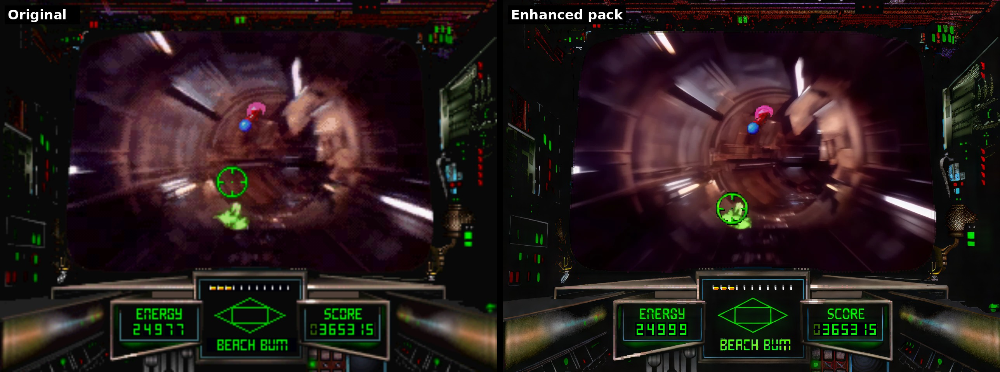
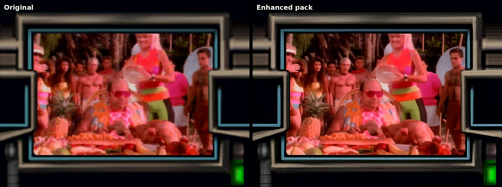
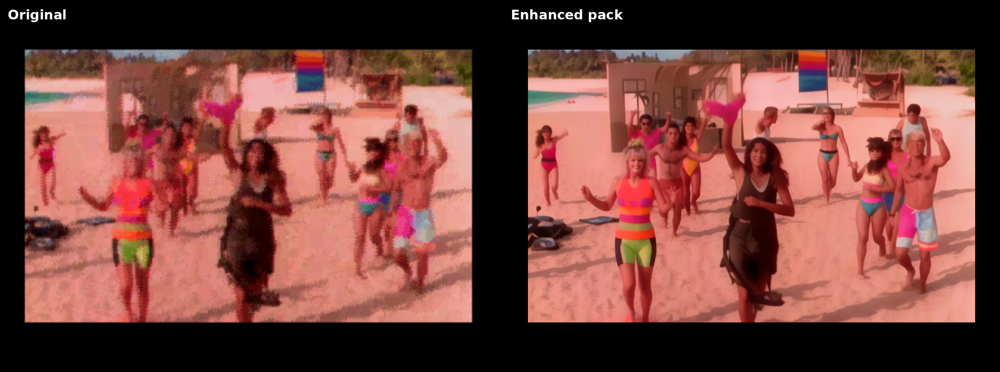

# 3DOverdrive (RetroArch core)

A RetroArch (libretro) core for playing 3DO full-motion-video games with
**enhanced video packs**: AI-restored, higher-resolution replacements for the
game's FMV, swapped in frame by frame while the original game runs.

3DOverdrive is built on [Opera](https://github.com/libretro/opera-libretro),
the libretro 3DO emulator. Everything Opera does still works the same way.
The core adds the enhanced-pack layer on top.

The first supported title is **Sewer Shark** (Digital Pictures, 1993).

## Downloads

- **Core:** prebuilt for Windows, Linux, macOS and Android on the
  [Releases page](https://github.com/TomSVR-Mister/3DOverdrive-RetroArch-core/releases).
- **Sewer Shark enhanced video pack:**
  [archive.org/details/sewer-shark-hd](https://archive.org/details/sewer-shark-hd)
  (`SewerSharkHD.3dov`, about 1.8 GB). It only works together with your own
  copy of the game.

## Screenshots

Original 3DO video on the left (scaled up), enhanced pack on the right.





## What the enhanced pack changes

- **Cutscenes and tunnel video:** every FMV frame is replaced by an
  AI-restored version at 4x the original resolution (1280x960 output).
- **Sprites and artwork:** creatures, explosions, the cockpit, HUD frames
  and logos use redrawn high-resolution versions. Score and energy digits
  stay original.
- **Pause screen:** the paused game is redrawn from the enhanced video.
- **Optional film grain** to take the "too smooth" look off restored faces.

The game logic, timing, sound and controls are untouched. The core only
changes what is drawn.

## What you need

- RetroArch.
- This core (see [Building](#building)), installed in RetroArch's `cores` folder.
- A 3DO BIOS, as for Opera (see [README-Opera.md](README-Opera.md)).
- Your own copy of the game.
- The enhanced pack for the game (see [Downloads](#downloads)). Packs are
  not part of this repository, and the game and BIOS are not distributed here.

Without a pack the core behaves like plain Opera.

## Installing a pack (Sewer Shark)

A pack is a single file, `SewerSharkHD.3dov`. Put it in RetroArch's
**System** folder (next to the BIOS) and load the game as usual.

The pack is encrypted with a key read from your own game disc, so it only
opens together with the game. CUE/BIN and ISO dumps both work, as
long as it is the same disc. If the pack does not match the disc, the core
logs a warning and runs the game with its original video.

The core looks for a pack in this order:

1. `SewerSharkHD.txt` in the System folder whose first line is the full path
   to a pack file (or to an unpacked pack folder).
2. `SewerSharkHD.3dov` in the System folder.
3. A folder named `SewerSharkHD` in the System folder (an unpacked pack, used
   while building one).
4. `SewerSharkHD.3dov`, or a `SewerSharkHD` folder, next to the game file.

## Core options

Under **Quick Menu > Core Options > Enhanced FMV**:

| Option | Values | Default |
| --- | --- | --- |
| Cutscene Video | Enhanced / Original | Enhanced |
| Gameplay Video | Enhanced / Original | Enhanced |
| Sprites and Artwork | Enhanced / Original | Enhanced |
| Film Grain | Off / Light / Medium | Off |
| Auto-Steer | Enabled / Disabled | Disabled |
| Auto-Flare | Enabled / Disabled | Disabled |
| Aim Assist | Enabled / Disabled | Disabled |
| Auto-Fire | Enabled / Disabled | Disabled |
| Infinite Energy (cheat) | Enabled / Disabled | Disabled |

Cutscene and gameplay video can be switched separately, so you can, for
example, keep the original tunnel footage and still watch restored cutscenes.

The last five options are play aids, all off by default:

- **Auto-Steer** takes the tube jumps you are told to take, and the open side
  of recharge stations.
- **Auto-Flare** fires hydrogen flares whenever the gas gauge climbs.
- **Aim Assist** pulls the crosshair onto the creature filmed into the
  current shot. Moving the stick or d-pad overrides it.
- **Auto-Fire** shoots only while the crosshair is on that creature, which
  saves energy.
- **Infinite Energy** keeps energy from running out.

## Save states and rewind

Save states work as in Opera. Opera's core info file marks save states as
"basic", so RetroArch turns rewind off for it. To use rewind, turn on
**Settings > Core > Bypass Core Info Save States Features**
(`core_info_savestate_bypass = "true"` in `retroarch.cfg`). This repository
keeps Opera's info file unchanged.

## Building

Same as Opera:

```sh
make                      # Linux
make platform=win CC=x86_64-w64-mingw32-gcc AR=x86_64-w64-mingw32-ar   # Windows (MinGW cross-compile)
```

Android: `ndk-build -C jni APP_ABI=arm64-v8a`. GitHub Actions builds all
platforms on every push (see `.github/workflows/build.yml`); pushing a
`v*` tag publishes a release.

The output keeps Opera's file name (`opera_libretro.so` / `opera_libretro.dll`),
so RetroArch shows it as Opera.

## Third-party code

- [Opera](https://github.com/libretro/opera-libretro) and its 4DO / FreeDO
  heritage: see [LICENSE](LICENSE).
- [libwebp](https://chromium.googlesource.com/webm/libwebp) decoder
  (`deps/libwebp`): BSD license, see `deps/libwebp/COPYING`.
- [stb_image](https://github.com/nothings/stb) (`stb_image.h`): public
  domain / MIT.

## License

Same terms as Opera, including the FreeDO conditions on commercial use: see [LICENSE](LICENSE).

Sewer Shark is a trademark of its respective owners. This project is not
affiliated with or endorsed by them, and contains no game data.
